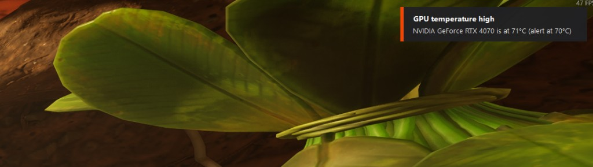

# TAS - Temperature Alert System

TAS is a small Windows program that watches your CPU and GPU temperatures and shows a Windows notification when either one goes above a limit you set. It runs in the system tray. Closing its window doesn't stop it; use **Exit** in the tray icon's right-click menu.

## Download

Get `TAS.exe` from the releases page:

**https://github.com/mistycodey/TAS/releases/latest**

It's a single file. There's nothing to install, and you don't need .NET. The same file is in the `release` folder of this project.

## Requirements

- Windows 10 or 11, 64-bit.
- Administrator rights. Windows asks you to confirm every time TAS starts, because reading hardware sensors needs it.
- For CPU temperatures, the free PawnIO driver. TAS can install it for you (see First run). GPU temperatures work without it.

## First run

1. Run `TAS.exe` and click **Yes** on the Windows prompt.
2. Open the **Setup** tab. A warning sign on the tab means something needs fixing.
3. If it says the sensor driver is needed, click **Install now**. TAS restarts when it's done.
4. Click **Send test alert** to check that Windows shows the notification.

## What it does

- Reads the CPU and GPU temperature every 5 seconds (you can change this).
- Shows a notification when a temperature reaches its limit. The CPU and GPU each have their own limit. The defaults are 85°C for the CPU and 80°C for the GPU.
- When Windows is hiding notifications (a game or full-screen app is in front, or Do Not Disturb is on), TAS shows its own small always-on-top popup instead (top-right, 10 seconds, click-through, never takes focus). The test alert always shows it. Turn it off in Settings. It shows over windowed and borderless-fullscreen games; a game in true exclusive full-screen mode can still cover it.
- Doesn't repeat itself every few seconds. After an alert, the temperature has to drop by a set amount before TAS alerts again. If it stays too hot, TAS reminds you every 10 minutes. You can change both, or set the reminder to 0 for a single alert.
- Can play a sound as well: a warning chime, a critical alarm, or a `.wav` file you choose.
- **Custom alerts**: alert on any other reading the hardware reports, such as GPU hot spot, memory temperature, load or fan speed. You choose "goes above" or "drops below" and a limit. **View Available Alerts** lists every sensor your hardware reports, with a one-line explanation of each, and lets you create an alert from any of them.
- **Snooze**: right-click the tray icon, then **Snooze alerts**, to pause alerts for 30 minutes, 1 hour or 2 hours.
- **History**: a graph of the last 10 minutes, 30 minutes or hour, with your limits drawn on it, plus the highest temperatures since TAS started. History isn't kept when TAS exits.
- Shows temperatures in °C or °F.
- Can log every reading to a CSV file you can open in Excel.
- Can start when you sign in to Windows, with no prompt. It does this with a scheduled task that you can remove by unticking the option.
- Shows every temperature sensor for the CPU and GPU, and marks the ones over your limit.

An alert from TAS appearing over a full-screen game:



The tray icon is a green dot that turns red when a temperature is over its limit.

## The tabs

The TAS window has five tabs. Open it by double-clicking the tray icon.

### Monitor

Live readings for the CPU (left) and GPU (right).

- The large number is the current temperature. It turns orange as it nears your limit and red when it's over.
- **Hottest sensor** names the sensor that number comes from.
- **Alert when above** is that device's temperature limit. Change it here and it takes effect straight away.
- Below the limit you'll see load, clock speed and power. The GPU also shows memory use and fan speed.
- The list at the bottom shows every temperature sensor the device reports.

### Alerts

Controls when and how TAS alerts you.

- **When to alert**: how often the sensors are checked, how far a temperature must cool before TAS alerts again, and how often it reminds you while it stays too hot (0 means alert once).
- **Alert sound**: choose no extra sound, a warning chime, a critical alarm, or your own `.wav` file. **Test sound** plays it.
- **Alert images**: optionally show a picture in an alert. Paste the web address (`http://` or `https://`) of a picture into the box for the CPU temperature alert and/or the GPU temperature alert. Put **one address per line** to use several: each alert then shows one of them, picked at random (up to 20 per alert). TAS downloads each image once and keeps a copy, and shows a status next to the box (for example **3 images ready**, or which image couldn't be used and why). The list is saved when you click out of the box. **Test** shows a sample alert with a random image from the list. An alert with an image appears in the TAS pop-up instead of the Windows notification (Windows notifications can't show pictures), so it needs **Show a TAS pop-up when Windows hides notifications** left ticked on the Settings tab. If the image can't be loaded, the alert is shown normally. The address doesn't need a file extension: TAS reads whatever the server sends (PNG, JPG, WebP, GIF and most other common formats), shrinks it if it's large and keeps it as a PNG. Animated images show their first frame only.
- **Custom alerts**: alerts on readings other than the CPU and GPU temperature limits. Each custom alert has its own optional list of **Images** in the alert editor, also one address per line.
  - **Manage custom alerts...** lists your alerts so you can add, edit, switch off or remove them.
  - **View Available Alerts** opens a window listing every sensor your hardware reports, grouped by device and type, with its current value and a one-line explanation of what it monitors. **Double-click any item to set up an alert for it**, or select it and click **Create alert for selected...**. TAS suggests a starting limit that you can change.

### History

A graph of recent temperatures.

- **Show** switches between the last 10 minutes, 30 minutes and hour.
- The CPU and GPU lines are drawn with your alert limits as dashed lines.
- Under the graph are the highest temperatures since TAS started.
- History is kept for the last hour and starts again when TAS restarts.

### Settings

- **General**
  - **Start TAS when I sign in to Windows** starts TAS quietly in the tray, with no UAC prompt.
  - **Show a TAS pop-up when Windows hides notifications** shows TAS's own alert over games and full-screen apps.
  - **Show temperatures in °F** only changes what TAS displays; your limits are converted for you.
- **Data**
  - **Log readings to a CSV file** adds a row at every check that you can open in Excel.
  - **Open data folder** opens the folder holding the settings, log and CSV files.

### Setup

Checks that TAS can do its job. A warning sign on the tab means something needs fixing.

- **Sensor driver**: whether the PawnIO driver is installed, with an **Install now** button if CPU temperatures need it.
- **Notifications**: whether Windows will show TAS alerts. **Send test alert** shows one, and **Notification settings** opens the Windows page.
- **Tray icon**: whether the TAS icon is visible on the taskbar. **Taskbar settings** opens the Windows page.
- **Help & setup guide** opens the built-in guide.

## If something doesn't work

- **The CPU shows n/a.** Install the PawnIO driver from the Setup tab. If it's already installed, restart TAS.
- **No notification appears.** Windows may be hiding it: check that notifications are on and Do Not Disturb is off. Games and full-screen apps can turn Do Not Disturb on by themselves. Held notifications still appear in the notification centre (click the clock). TAS also writes every alert to its log file.
- **A value shows n/a.** Not every CPU or GPU reports every sensor.

## Files

| File | Location |
| --- | --- |
| Settings | `%APPDATA%\TAS\settings.json` |
| Alert log | `%APPDATA%\TAS\tas.log` |
| Readings (only if CSV logging is on) | `%APPDATA%\TAS\readings.csv` |
| Downloaded alert images | `%APPDATA%\TAS\images\` |

## Building from source

You need the [.NET 8 SDK](https://dotnet.microsoft.com/download/dotnet/8.0).

```powershell
cd src\TAS
dotnet build
```

To produce the single-file release:

```powershell
cd src\TAS
dotnet publish -c Release -r win-x64 --self-contained -p:PublishSingleFile=true -p:EnableCompressionInSingleFile=true -p:IncludeNativeLibrariesForSelfExtract=true -p:DebugType=none -o ..\..\release
```

## Third-party components

- [LibreHardwareMonitorLib](https://github.com/LibreHardwareMonitor/LibreHardwareMonitor) (MPL-2.0) reads the hardware sensors.
- The [PawnIO](https://pawnio.eu) installer (version 2.2.0) is embedded in TAS so it can install the driver for you. Check PawnIO's licence terms before you redistribute TAS.
